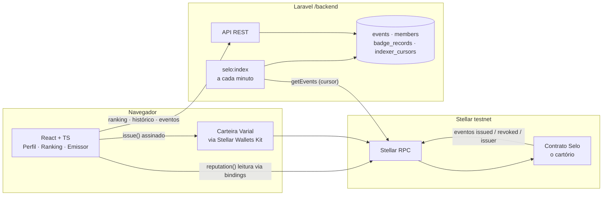
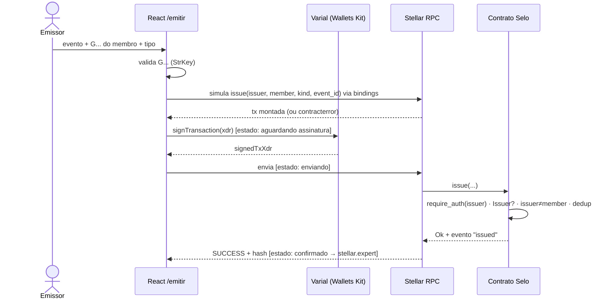
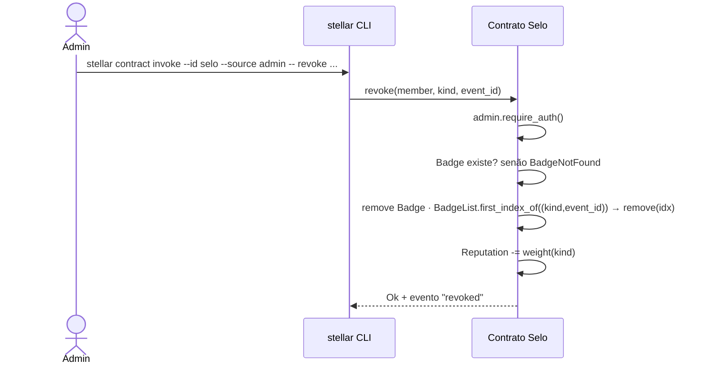
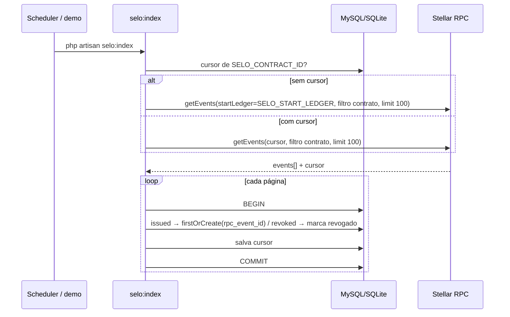

# Selo — Design

> SDD 2/3 · Assinaturas e interfaces apenas (sem implementação) · Fonte da verdade junto com `requirements.md` e `tasks.md`

## 1. Arquitetura



**On-chain vs off-chain** (o ponto didático da tela de Perfil):

| Dado | Onde vive | Por quê |
|---|---|---|
| Badge ativo, reputação, emissores | Contrato (cartório) | Verdade pública, ninguém altera sozinho |
| Nome/data/local do evento, apelido, avatar | Laravel | Não precisa de consenso e custaria taxa |
| Histórico com revogados | Laravel (arquivo morto) | O contrato apaga o badge revogado (RN-06) |

## 2. Contrato Soroban

Crate `selo`, `#![no_std]`, `soroban-sdk` na versão fixada pelo template do `stellar contract init`. Ela precisa ser >= 23, porque `#[contractevent]` substitui o `events().publish` que foi depreciado; o design foi conferido na 26.1.1, e a última estável hoje é a 29.0.1.

### 2.1 Tipos

```rust
#[contracttype]
#[derive(Clone, Copy, Debug, Eq, PartialEq)]
pub enum BadgeKind { Participante, Mentor, Organizador, Palestrante }

pub fn weight(kind: BadgeKind) -> u32; // Participante=1, Mentor=3, Organizador=3, Palestrante=5

#[contracttype]
#[derive(Clone, Debug, Eq, PartialEq)]
pub struct Badge {
    pub kind: BadgeKind,
    pub event_id: u32,
    pub issuer: Address,
    pub issued_at: u64, // env.ledger().timestamp()
}
```

### 2.2 Storage

```rust
#[contracttype]
pub enum DataKey {
    Admin,                           // instance   -> Address
    Issuer(Address),                 // persistent -> bool
    Badge(Address, BadgeKind, u32),  // persistent -> Badge  (também é a chave de dedup — RN-03)
    BadgeList(Address),              // persistent -> Vec<(BadgeKind, u32)>
    Reputation(Address),             // persistent -> u32
}
```

TTL: toda escrita em chave `persistent` chama `env.storage().persistent().extend_ttl(&key, TTL_THRESHOLD, TTL_EXTEND_TO)`. Toda escrita no storage também estende a instância com `env.storage().instance().extend_ttl(...)`.

| Constante | Valor | Equivale a |
|---|---|---|
| `TTL_THRESHOLD` | `17_280 * 30` ledgers | ~30 dias |
| `TTL_EXTEND_TO` | `17_280 * 120` ledgers | ~120 dias (abaixo do TTL máximo da rede) |

### 2.3 Erros

```rust
#[contracterror]
#[derive(Copy, Clone, Debug, Eq, PartialEq, PartialOrd, Ord)]
#[repr(u32)]
pub enum Error {
    AlreadyInitialized = 1,
    NotInitialized     = 2,
    NotAdmin           = 3,
    NotIssuer          = 4,
    SelfIssue          = 5,
    AlreadyHasBadge    = 6,
    BadgeNotFound      = 7,
}
```

Sobre o `NotAdmin` (3): como o admin vem do storage e se chama `admin.require_auth()`, uma chamada sem a assinatura do admin falha **na auth do host**, não com `NotAdmin`. O código fica reservado e fica documentado nas Decisões (D-04).

### 2.4 Eventos (`#[contractevent]`, formato de dados padrão: map)

```rust
#[contractevent(topics = ["issuer"])]
pub struct IssuerEvent  { #[topic] pub issuer: Address, pub enabled: bool }

#[contractevent(topics = ["issued"])]
pub struct IssuedEvent  { #[topic] pub member: Address, pub kind: BadgeKind, pub event_id: u32, pub issuer: Address, pub issued_at: u64 }

#[contractevent(topics = ["revoked"])]
pub struct RevokedEvent { #[topic] pub member: Address, pub kind: BadgeKind, pub event_id: u32 }
```

Em todo evento, os tópicos são `[Symbol(nome), Address]` e o valor é um `ScMap` com os campos restantes. Um `BadgeKind` aparece em XDR como `ScVec[Symbol("Participante")]`.

### 2.5 Funções

| Função | Auth | Pré-condições (ordem de checagem) | Pós-condições | Evento |
|---|---|---|---|---|
| `init(env, admin: Address) -> Result<(), Error>` | — | `Admin` não existe, senão `AlreadyInitialized` | grava `Admin` (instance) | — |
| `set_issuer(env, issuer: Address, enabled: bool) -> Result<(), Error>` | `admin.require_auth()` | `Admin` existe, senão `NotInitialized` | `Issuer(issuer) = enabled` + TTL | `issuer` |
| `issue(env, issuer: Address, member: Address, kind: BadgeKind, event_id: u32) -> Result<(), Error>` | `issuer.require_auth()` | 1) `Issuer(issuer) == true`, senão `NotIssuer` · 2) `issuer != member`, senão `SelfIssue` · 3) `Badge(member,kind,event_id)` não existe, senão `AlreadyHasBadge` | grava `Badge`; faz `push_back((kind,event_id))` em `BadgeList`; `Reputation += weight(kind)` (checked); TTL das 3 chaves | `issued` |
| `revoke(env, member: Address, kind: BadgeKind, event_id: u32) -> Result<(), Error>` | `admin.require_auth()` | `Admin` existe, senão `NotInitialized` · `Badge(...)` existe, senão `BadgeNotFound` | remove `Badge`; em `BadgeList` acha o índice com `first_index_of((kind,event_id))` e chama `remove(idx)` (**por valor, nunca por posição recebida**); `Reputation -= weight(kind)` (checked); TTL de `BadgeList` e `Reputation` | `revoked` |
| `reputation(env, member: Address) -> u32` | — | — | retorna `Reputation` ou `0` | — |
| `badges_of(env, member: Address) -> Vec<Badge>` | — | — | percorre `BadgeList` e retorna o `Badge` de cada chave | — |

Invariante: `Reputation(m) == Σ weight(kind)` dos itens em `BadgeList(m)`. Por isso o `checked_sub` do revoke nunca estoura. Se estourar, o contrato está com bug e o `panic` explícito com a mensagem "reputation invariant" é o comportamento certo.

Não existe nenhuma função de transferência e o contrato não implementa SEP-41 (RN-02).

### 2.6 Testes obrigatórios (`cargo test`)
- Para cada função pública: caminho feliz, falta de auth e cada erro que ela pode retornar.
- Emitir 3 badges, revogar o do **meio**, e conferir `badges_of` (2 itens, na ordem certa) e `reputation`.
- Emitir duplicado → `AlreadyHasBadge`. Revogar e reemitir → sucesso (RN-06).
- Emissor para si mesmo → `SelfIssue`.
- Emissor desativado → `NotIssuer`, e os badges antigos dele continuam em `badges_of` (RN-07).
- `init` duas vezes → `AlreadyInitialized`; `set_issuer`/`revoke` antes do `init` → `NotInitialized`.
- Cada função que muda estado gera o evento esperado (`env.events().all()`).

### 2.7 Diagrama — issue



### 2.8 Diagrama — revoke



Não existe tela de revoke: ele é feito pela CLI, e isso está fora das 3 telas do escopo.

## 3. Laravel (`/backend`)

Stack: Laravel (última versão do `composer create-project laravel/laravel`, PHP 8.5) + `soneso/stellar-php-sdk` (1.17.x). As rotas de API são habilitadas com `php artisan install:api`.

### 3.1 `.env` (nunca versionado; `.env.example` sem valores secretos)

```
SELO_CONTRACT_ID=C...
SELO_RPC_URL=https://soroban-testnet.stellar.org
SELO_START_LEDGER=<ledger obtido com `stellar ledger latest` antes do deploy>
SELO_ADMIN_TOKEN=<aleatório>
FRONTEND_URL=http://localhost:5173
```

### 3.2 Migrations

| Tabela | Colunas |
|---|---|
| `events` | `id` PK, `name` string, `date` date, `location` string, `description` text null, timestamps |
| `members` | `id` PK, `address` string(56) **unique**, `nickname` string null, `avatar_url` string null, timestamps |
| `badge_records` | `id` PK, `rpc_event_id` string **unique**, `member_address` string(56) index, `kind` enum(Participante, Mentor, Organizador, Palestrante), `event_id` unsignedInteger index, `issuer` string(56), `status` enum(issued, revoked) default issued, `tx_hash` string(64), `ledger` unsignedInteger, `issued_at` timestamp, `revoked_at` timestamp null, timestamps |
| `indexer_cursors` | `id` PK, `contract_id` string(56) **unique**, `cursor` string, timestamps |

Pesos no PHP: um enum `App\Enums\BadgeKind` com `weight(): int` **idêntico** ao `weight()` do contrato (D-06).

### 3.3 Endpoints

**`GET /api/events`** → 200
```json
[{ "id": 1, "name": "PHP Manaus — Webinar Selo", "date": "2026-11-07", "location": "Online", "description": "..." }]
```

**`POST /api/events`**: header `X-Admin-Token`, comparado com `SELO_ADMIN_TOKEN` usando `hash_equals`.
Request `{ "name": "...", "date": "YYYY-MM-DD", "location": "...", "description": "..."? }` → 201 com o evento · 401 `{ "message": "Unauthorized" }` · 422 se a validação falhar.

**`GET /api/members/{address}`**: `address` validado com `StrKey::isValidAccountId` (inválido → 422). Um endereço sem registros retorna 200 com a lista vazia, porque o visitante pode consultar qualquer passaporte.
```json
{
  "address": "G...", "nickname": null, "avatar_url": null,
  "points": 4,
  "badges": [
    { "kind": "Mentor", "weight": 3, "event": { "id": 1, "name": "..." }, "issuer": "G...",
      "status": "issued", "tx_hash": "...", "ledger": 123456, "issued_at": "2026-11-07T19:10:00Z", "revoked_at": null }
  ]
}
```
`points` = Σ `weight` dos registros com `status = issued`. `event` vem `null` se o `event_id` não existir no Laravel (RN-09).

**`GET /api/ranking`** → 200, top 20 por `points` de badges ativos, em ordem decrescente:
```json
[{ "position": 1, "address": "G...", "nickname": null, "points": 8, "badges": 3 }]
```

CORS: `config/cors.php` (gerado com `php artisan config:publish cors`) com `allowed_origins = [env('FRONTEND_URL')]`, só para `api/*`.

### 3.4 Indexador `php artisan selo:index`

- Usa `SorobanServer(SELO_RPC_URL)->getEvents(GetEventsRequest)` com `EventFilter(type: "contract", contractIds: [SELO_CONTRACT_ID])` e `PaginationOptions(limit: 100)`.
- **Sem cursor salvo:** usa `startLedger = SELO_START_LEDGER`. **Com cursor:** passa só `PaginationOptions(cursor)`, sem `startLedger`, porque o RPC trata os dois como mutuamente exclusivos.
- Para cada `EventInfo`: `topic[0]` é decodificado com `XdrSCVal::fromBase64Xdr` e vira o Symbol do evento; `topic[1]` vira o `Address` (`Address::fromXdrSCVal(...)->getAccountId()`); `value` vira um ScMap com os campos da §2.4.
  - `issued` → `firstOrCreate` em `badge_records` pela chave `rpc_event_id = EventInfo::getId()`, com `tx_hash`, `ledger` e `issued_at` (vindo do `issued_at` do evento).
  - `revoked` → se `rpc_event_id` já foi processado, ignora. Senão, marca `status=revoked, revoked_at=ledgerClosedAt` no registro `issued` mais recente com o mesmo `(member, kind, event_id)` e com `ledger <= ledger do revoke`. O id do revoke fica gravado para garantir a idempotência (D-07).
  - `issuer` → é ignorado, porque não existe tabela de emissores no escopo.
- Cada página é processada numa **transação de banco** que grava os registros e o novo `cursor` (`GetEventsResponse::getCursor()`) juntos. O loop continua até vir uma página vazia.
- Se o `startLedger` for anterior ao `getOldestLedger()` do RPC, o comando falha com uma mensagem clara pedindo para atualizar o `SELO_START_LEDGER`.
- O agendamento fica em `routes/console.php`: `Schedule::command('selo:index')->everyMinute()->withoutOverlapping()`.

### 3.5 Diagrama — indexação



## 4. React + TypeScript (`/frontend`)

- Criado com `npm create vite@latest frontend -- --template react-ts`, mais `react-router-dom`.
- Bindings: `stellar contract bindings typescript --contract-id selo --network testnet --output-dir bindings/selo` geram um pacote npm local. Ele é buildado e instalado no frontend como dependência `file:`. **Nunca se monta XDR na mão.**
- Carteira: **`@creit.tech/stellar-wallets-kit` 2.8.0**, que exporta o `VarialModule` (`./modules/varial`). Uso: `StellarWalletsKit.init({ modules: [new VarialModule()], network: Networks.TESTNET })`, depois `authModal()`/`getAddress()` e `signTransaction(xdr, { networkPassphrase, address })` → `{ signedTxXdr }`. A alternativa direta, sem o kit, é `@stellar/varial-sdk` 7.0.0 (publicado pela SDF em 28/10/2026). Fica registrada e não é usada (D-02).
- Variáveis de ambiente (`.env.local`, não versionado; `.env.example` versionado):
  `VITE_SELO_CONTRACT_ID`, `VITE_RPC_URL=https://soroban-testnet.stellar.org`, `VITE_NETWORK_PASSPHRASE="Test SDF Network ; September 2015"`, `VITE_API_URL=http://localhost:8000/api`.
- Visual: fonte base grande (≥ 18px), contraste alto, legível em tela compartilhada.

### 4.1 Telas e estados

| Rota | Fonte de dados | Estados |
|---|---|---|
| `/` Ranking | `GET /api/ranking` | carregando · vazio ("nenhum selo ainda") · lista · erro de API |
| `/m/:address` Perfil | **Coluna "on-chain":** `reputation()` + `badges_of()` pelos bindings (simulação, sem carteira). **Coluna "off-chain":** `GET /api/members/{address}` (com revogados) | endereço inválido · carregando (cada coluna independente) · dados · erro por coluna |
| `/emitir` Emissor [DEMO] | carteira + `GET /api/events` + `issue()` pelos bindings | desconectado · conectado · formulário inválido · **aguardando assinatura → enviando → confirmado** (link `https://stellar.expert/explorer/testnet/tx/<hash>`) · **erro** traduzido |

### 4.2 Tradução de erros (código do `contracterror` → mensagem)

| Código | Erro | Mensagem |
|---|---|---|
| 1 | AlreadyInitialized | "O contrato já foi inicializado" |
| 2 | NotInitialized | "O contrato ainda não foi inicializado" |
| 3 | NotAdmin | "Apenas o administrador pode fazer isso" |
| 4 | NotIssuer | "Sua carteira não está credenciada como emissora" |
| 5 | SelfIssue | "Você não pode emitir um selo para si mesmo" |
| 6 | AlreadyHasBadge | "Esse membro já tem esse selo neste evento" |
| 7 | BadgeNotFound | "Selo não encontrado" |
| — | assinatura recusada / outro | "Assinatura cancelada" / "Erro inesperado: <detalhe>" |

O código sai do erro de simulação/envio retornado pelos bindings (`Error(Contract, #N)`). O mapeamento usa o `Errors` exportado pelo pacote gerado, então é preciso conferir o formato exato no código gerado antes de implementar.

## 5. Ameaças e defesas

| Ameaça | Cenário | Defesa |
|---|---|---|
| **Carimbo indevido** | Alguém que não é emissor tenta emitir | `issuer.require_auth()` exige a assinatura do próprio emissor, e `Issuer(issuer) == true` é checado no storage (`NotIssuer`). Só o admin altera `Issuer` (`admin.require_auth()`). |
| **Auto-emissão** | Emissor infla a própria reputação | `issuer != member` → `SelfIssue` (RN-04). Testado. |
| **Duplicidade** | Mesmo badge emitido 2x; indexador grava 2x | On-chain: a chave `Badge(member, kind, event_id)` é o dedup (`AlreadyHasBadge`). Off-chain: `rpc_event_id` unique + `firstOrCreate` + cursor salvo na mesma transação. |
| **Revoke na posição errada** | Remover por índice apaga o badge errado depois de revogações anteriores | `revoke` não recebe índice: busca `first_index_of((kind, event_id))` em `BadgeList`. Teste "revogar o do meio". |
| **Admin único** | Chave do admin vazada ou perdida: revogações e credenciamentos arbitrários, ou nenhum | Chave só no keystore do Stellar CLI (nunca em arquivo versionado); o admin não emite badges; multisig do admin fica para a próxima versão. |
| **Front-run do `init`** | Entre o deploy e o `init`, outra conta chama `init` e vira admin | `init` roda logo depois do deploy (T07), e o critério de pronto confere que o admin gravado é o esperado. Alternativa melhor registrada em D-03. |
| **Token de admin da API** | Força bruta / timing no `X-Admin-Token` | `hash_equals`, token aleatório só no `.env`, 401 sem detalhes. |
| **Indexador envenenado** | Eventos de outro contrato com os mesmos tópicos | O filtro do `getEvents` usa `contractIds = [SELO_CONTRACT_ID]`. |
| **Endereço inválido na UI** | Assinatura desperdiçada / tx com erro | Validação StrKey no formulário antes de pedir assinatura, e no Laravel (422). |

## 6. Decisões

| ID | Decisão | Motivo |
|---|---|---|
| D-01 | Toolchain = **Stellar CLI**. O contract ID fica no alias `selo` (`deploy --alias selo`). Não se usa Caatinga. | Pedido do autor do workshop; os comandos foram conferidos no `--help` do CLI 27.1.0. |
| D-02 | Carteira via **Stellar Wallets Kit 2.8.0** (`VarialModule`). `@stellar/varial-sdk` 7.0.0 fica como alternativa. | O prompt pede para preferir o Kit se ele suportar a Varial, e ele suporta (conferido no pacote publicado). |
| D-03 | Mantido o `init(admin)` do design fechado, apesar do risco de front-run. A correção mínima possível na API real seria `__constructor(admin)` no deploy (atômico). | O design está fechado; a mitigação é chamar o `init` logo depois do deploy e verificar. Proposta de mudança, **não aplicada**. |
| D-04 | `NotAdmin` (3) fica reservado. A falta de assinatura do admin falha na auth do host. | Com `require_auth` sobre o admin gravado, não existe caminho no código que retorne `NotAdmin`. Isso evita inventar uma checagem artificial. |
| D-05 | Os eventos usam `#[contractevent(topics = [...])]`, e não `env.events().publish`. | `publish` está depreciado no soroban-sdk atual. Os nomes `issuer`/`issued`/`revoked` são mantidos como 1º tópico. |
| D-06 | Os pesos ficam duplicados no PHP (`BadgeKind::weight`). | O ranking do Laravel conta os badges ativos sem chamar o contrato. Um teste do Laravel fixa os mesmos valores. |
| D-07 | O revoke indexado marca o `issued` mais recente com `ledger <=` ledger do revoke. | Assim o reprocessamento de um revoke antigo não revoga um badge reemitido depois (RN-06). |
| D-08 | O workspace do contrato fica em `selo/` (gerado por `stellar contract init selo --name selo`), o Laravel em `backend/`, o React em `frontend/` e os bindings em `bindings/selo/`. | Os caminhos reais serão confirmados depois do init e registrados no topo do `tasks.md`. |
| D-09 | O revoke é feito só pela CLI, sem tela. | As 3 telas do escopo não incluem revoke. |
